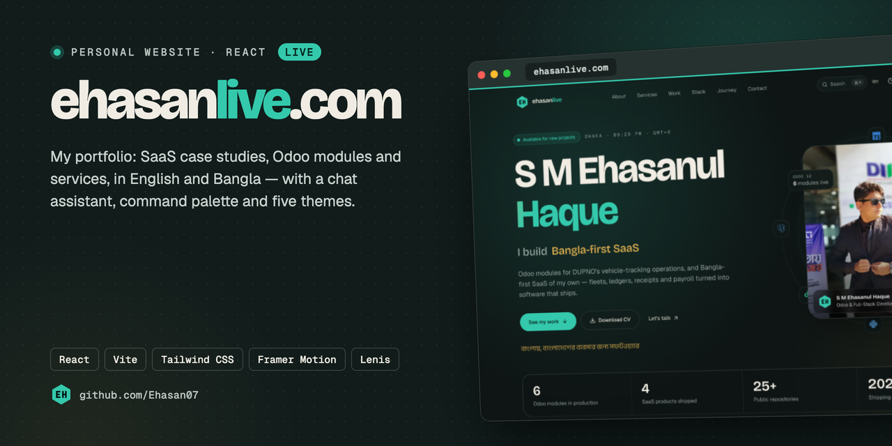

<!-- banner -->
<p align="center"></p>

<p align="center"><a href="https://ehasanlive.com"><b>Live: ehasanlive.com</b></a> · <a href="#features">Features</a></p>
<!-- /banner -->

# ehasanlive.com

Personal website of **S M Ehasanul Haque** — Odoo & full-stack developer at DUPNO International, Dhaka.
It shows the SaaS products I've shipped (Hajj Tracking, Taka Tracker, Trade ERP, MY-Card), the Odoo 12
modules I built for DUPNO, my stack, my journey, and a way for clients to start a project.

## Features

- **Bangla + English** — every line of content switches language, including the chat assistant.
- **Dark / light / system theme** and five accent colors (Emerald, Gold, Ocean, Violet, Rose), saved per device and applied before first paint.
- **Command palette** — <kbd>⌘K</kbd> / <kbd>Ctrl K</kbd> jumps to any section or project, copies the email, downloads the CV, switches theme or language.
- **Case studies** — each product and Odoo module opens in a modal with screenshots, highlights, stack and links.
- **Fabrito, the chat assistant** — answers questions about projects, Odoo work, stack and hiring from the site's own data (no external API), in Bangla or English, with quick-reply chips and action buttons.
- **Motion** — Lenis smooth scrolling, stacking product cards, letter-by-letter hero, orbiting stack, magnetic buttons, pointer-following spotlights. A "Reduced motion" setting (and the OS preference) turns it all down.
- **Contact form** — sends through EmailJS when configured, otherwise opens the visitor's email app with the message filled in; one-tap WhatsApp too.
- **SEO** — Open Graph / Twitter cards, JSON-LD `Person` schema, sitemap and robots.txt.

## Stack

React 19 · Vite 7 · Tailwind CSS 3 · Framer Motion · Lenis · react-icons / lucide-react · EmailJS (optional).
Fonts: Bricolage Grotesque, Geist, Geist Mono and Anek Bangla.

## Project structure

```
src/
├── data/            # all content — edit these to update the site
│   ├── profile.js   #   name, contact, bio, stats, principles
│   ├── projects.js  #   SaaS products, Odoo modules, other projects
│   ├── skills.js    #   stack groups + Odoo capabilities
│   ├── services.js  #   services + working process
│   └── journey.js   #   experience, education, timeline
├── i18n/strings.js  # interface text in English and Bangla
├── context/         # SettingsContext (theme, accent, language, motion), UIContext (overlays, toast)
├── sections/        # Hero, About, Services, Work, Skills, Journey, Contact
├── components/
│   ├── layout/      # Navbar, Footer, background, smooth scroll, intro
│   ├── work/        # product cards, case-study modal
│   ├── chat/        # Fabrito widget + its answer engine
│   └── ui/          # Reveal, SpotlightCard, Magnetic, CountUp, TechIcon, Logo…
├── hooks/  lib/
public/
├── work/            # project screenshots (WebP)
├── resume.pdf  profile.webp  og-image.jpg  favicon.svg
└── CNAME  _headers  robots.txt  sitemap.xml
```

Text is written as `{ en: "...", bn: "..." }`; components pick the right one with `tr()` from `useSettings()`.

## Run locally

```sh
git clone https://github.com/Ehasan07/Protfolio.git
cd Protfolio
npm install
npm run dev        # http://localhost:5173
```

`npm run build` writes the production site to `dist/`; `npm run lint` checks the code.

### Contact form (optional)

Copy `.env.example` to `.env` and fill in your EmailJS service, template and public key.
Without them the form falls back to `mailto:` — nothing breaks.

## Deploy

The site is hosted on **Cloudflare Pages** (project `ehasanlive`) as a direct upload:

```sh
npm run deploy     # vite build + wrangler pages deploy dist --project-name ehasanlive
```

Wrangler asks you to log in to Cloudflare the first time. If you use EmailJS, set the `VITE_EMAILJS_*`
variables in `.env` before deploying — Vite bakes them in at build time.

## Contact

S M Ehasanul Haque — [shiplulink2003@gmail.com](mailto:shiplulink2003@gmail.com) · [ehasanlive.com](https://ehasanlive.com) · [GitHub](https://github.com/Ehasan07)
